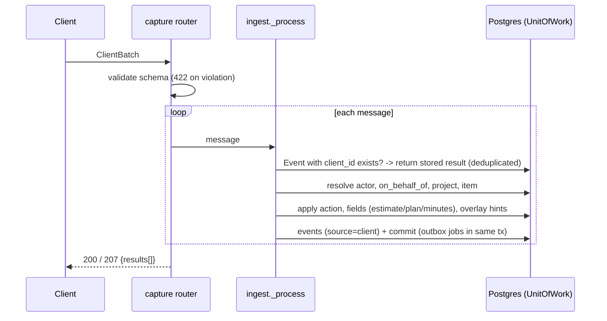

# Capture pipeline (`POST /api/v1/w/{ws}/capture/batches`)

Input: a `ClientBatch` (`tt_schema.client`). Each message runs in **its own transaction**; all messages of a batch
share `correlation_id = batch_id`. Only a schema violation rejects (422, body names `message_index`); a message that
fails internally returns `status: failed` and the batch answers `207`.

## Steps (Phase 1 §1.4)
1. **Idempotency** — the first event of a message carries `client_id` (unique) and the full `result` in its payload;
   a replay returns that result with `status: deduplicated`.
2. **Actor** — `@handle` -> `WorkspaceMember` (unknown actor = `failed/unknown_actor`). `on_behalf_of` is honoured only
   with a `ReportingLine` (actor is the manager) or a shared team; otherwise warning `on_behalf_of_ignored`.
3. **Project** — key (ci) -> name -> `settings.aliases` -> `workspace.settings.glossary` -> subject's Inbox.
4. **Item** — id -> key -> fuzzy title (ADR-0002) -> create (`reporter=actor`, `assignee=subject`, provisional in Inbox).
   Messages without an item use the subject's single current activity for `pause/resume/done/note/evidence/log_time`.
5. **Action**

| action | effect |
|---|---|
| `start` | pause the person's active activities (`activity.paused`, reason `auto_switch`), new active `Activity`, set `actual_start`, state -> first `active` state (reopens a done item: `item.reopened`) |
| `pause` / `resume` | `paused` / `active` on the item's current activity (`resume` with nothing paused starts a new one) |
| `done` | end open activities, state -> terminal, `actual_end`/`resolved_at`/`closed_at` (`item.finished`) |
| `blocked` | end working activities, new `Activity{kind=blocked, note}` (`activity.blocked`, `item.blocked`) |
| `note` / `evidence` | `Evidence` on the current/most recent activity (a zero-length `other` activity is created if none) |
| `estimate` / `plan` / `log_time` / `create` / `update` | handled by the field step below |

6. **Fields (any action)** — `estimate` -> `Estimate` (first = original, later = revised; original syncs the item),
   `planned_end` -> item (date in the person's zone), `minutes` -> `TimeEntry` dated in the person's zone.
7. **Overlay hints** — `tags` (create-on-use, provisional), `priority`, `item_type`, `parent`, `milestone`,
   `iteration`, `assignees`, `custom_fields`. A hint is applied only if `llm_confidence[field] >= 0.7` (absent = trusted);
   anything unresolved or low-confidence becomes a `ReviewItem`. `stage`, `product`, `risks` are stored as
   `deferred_*` review items until Phase 3.
8. **Events** — `item.created|matched`, `activity.*`, `time.logged`, `evidence.added`, `estimate.set`,
   `item.planned_end_set`, `item.state_changed`, `review.created`, ... all `source=client`.

## Response per message
`{client_id, status: applied|applied_with_warnings|deduplicated|failed, item:{id,key,title,project_key}, activity_id,
warnings[], review_item_ids[], error_code, resolution}`.

## Plan linkage (after step 6)
A task *created* by the pipeline in a non-Inbox project that has deliverables is attached to one (glossary → trigram ≥ 0.5) or becomes an `unlinked_task` review row with three suggestions. See `docs/api/plan.md`.

## Phase 15 additions (personal tracker)
* `ClientMessage.source{origin, calendar_ref{provider, event_id, series_id, instance_start}}` and `corrects` are optional (schema minor `0.2`; `0.1` clients keep working).
* A message that logs minutes with a `calendar_ref` is deduplicated on `(workspace, person, provider, event_id, instance_start)`: the second answers `status: deduplicated` with the original item and writes no event (ADR-0054).
* `action: update` with `corrects: <client_id>` removes that client message's time entry (only its owner; emits `time.unlogged`; unknown or foreign targets give warning `unlog_target_not_found`).
* A message whose `project` is the workspace `development.project_key` (default `DEV`) creates that project on first use; its items are private and tagged `development` (ADR-0055).
